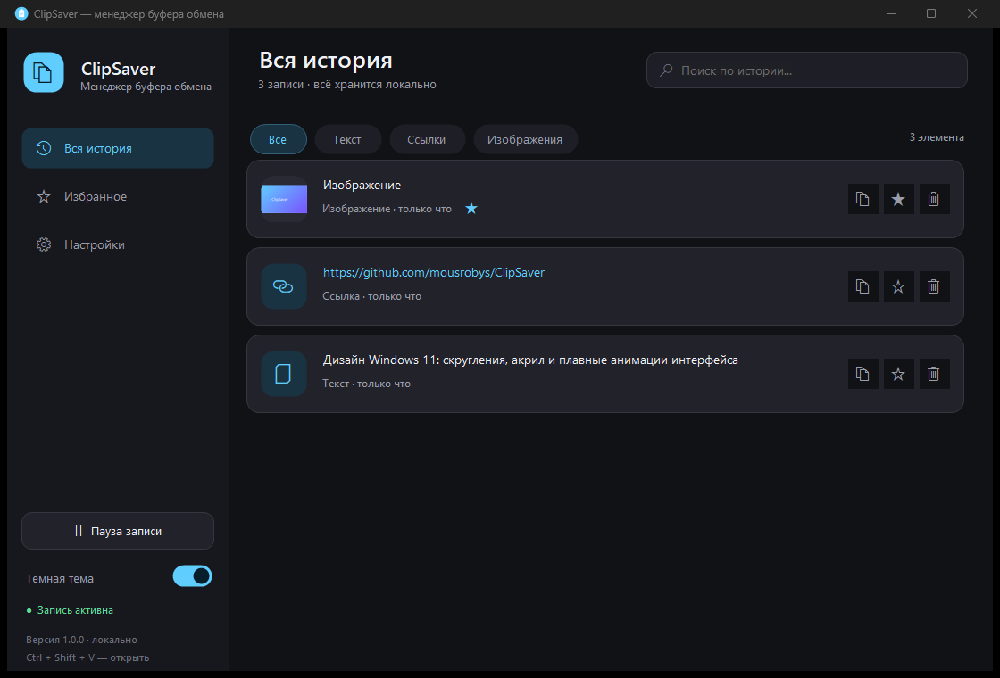
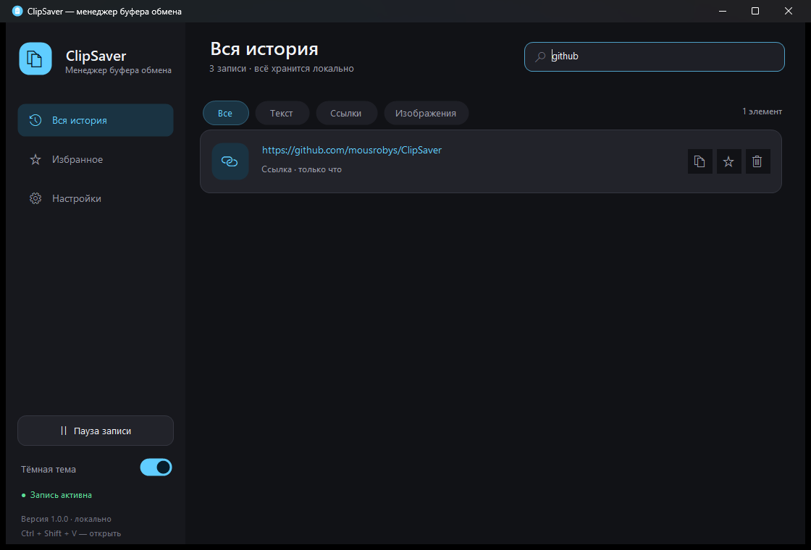
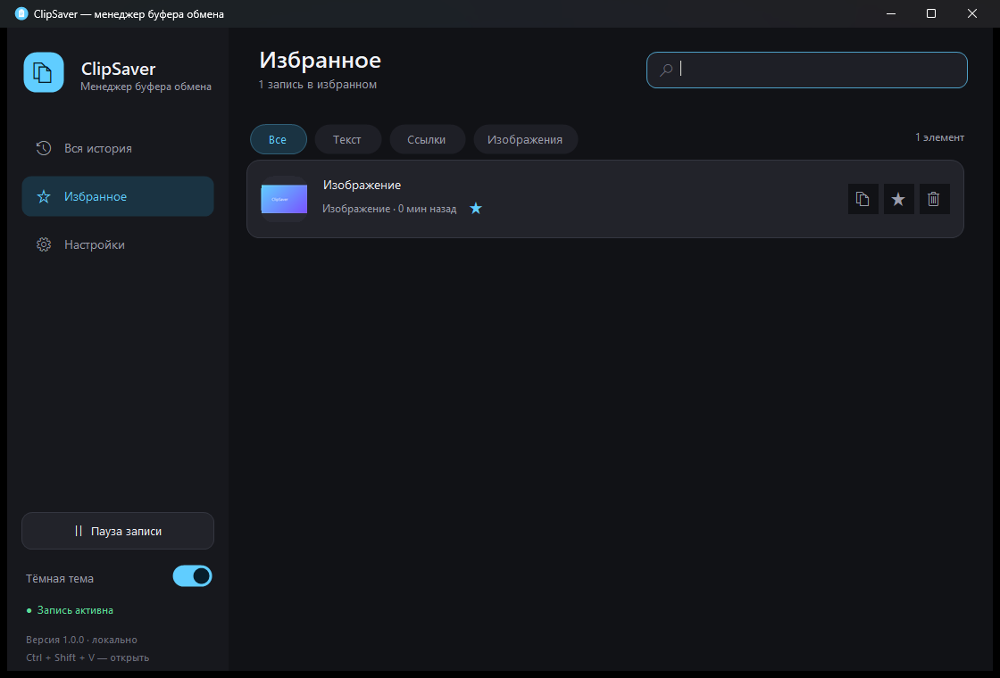
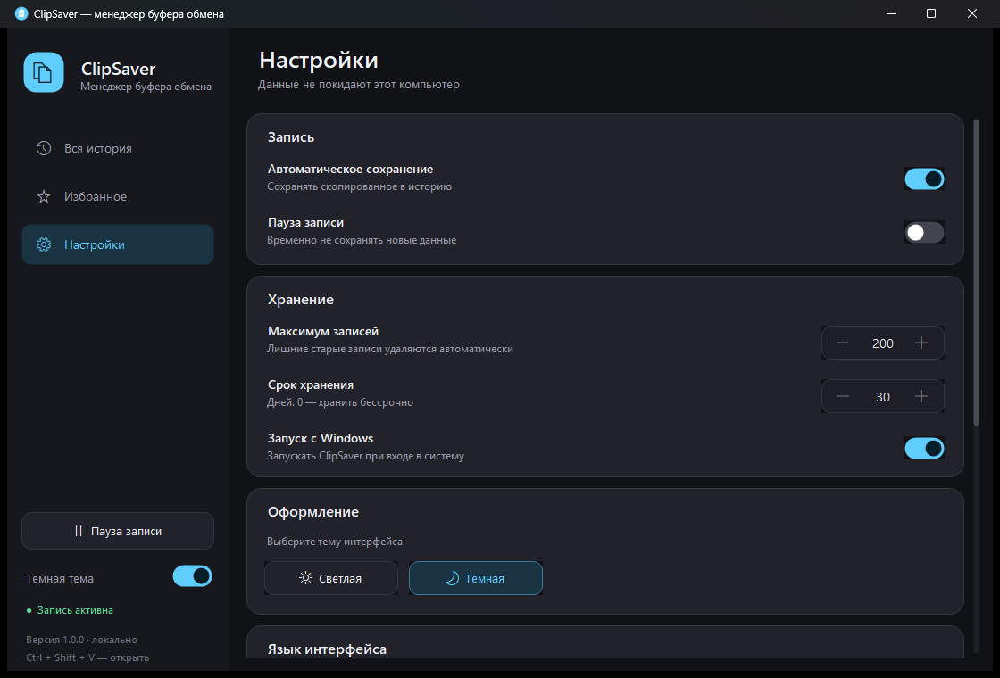
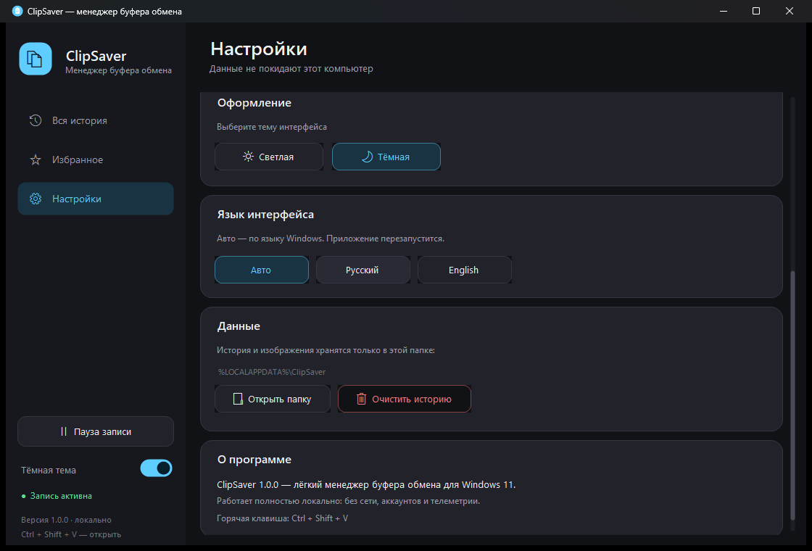
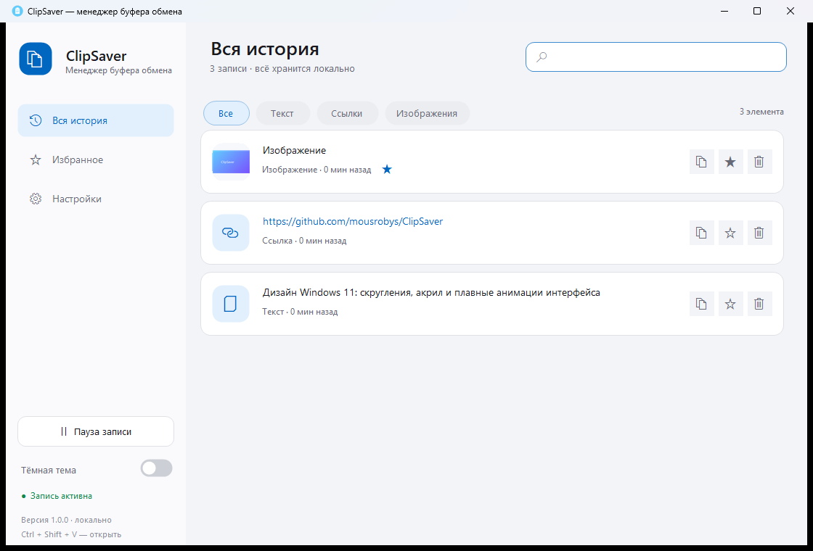
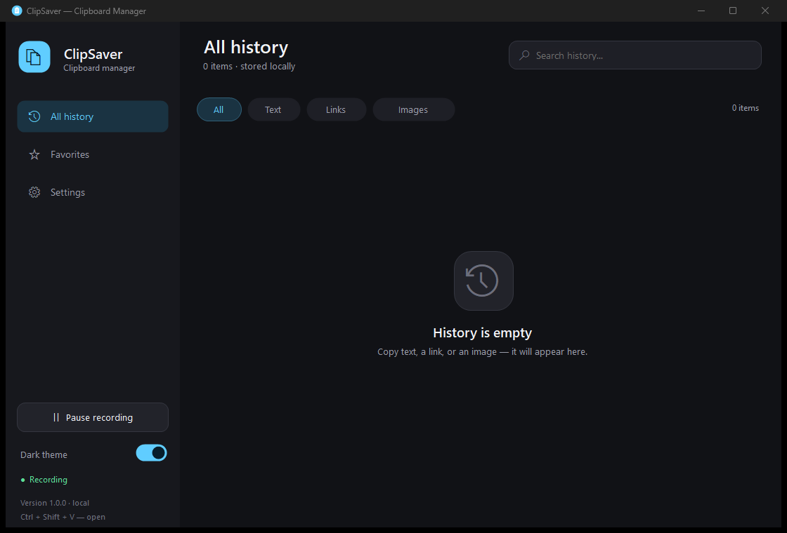
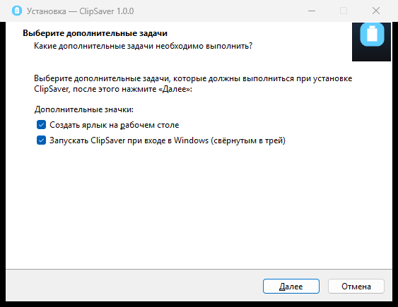

# ClipSaver

**Lightweight local clipboard manager for Windows 11.**

[](https://github.com/mousrobys/ClipSaver/releases/latest)
[](LICENSE)
[](#requirements)

ClipSaver automatically saves copied text, links, and images, lets you browse and search your history, pin favorites, and quickly copy items back to the clipboard. It runs quietly in the background and opens instantly with **Ctrl + Shift + V**.

- **Version:** 1.0.0
- **Platform:** Windows 11 (x64)
- **Technology:** C#, .NET 8, Windows Forms, Win32 API, System.Text.Json
- **Languages:** Russian and English with automatic detection
- **Theme:** Dark by default; light theme available

## Download

Download the latest build from **[GitHub Releases](https://github.com/mousrobys/ClipSaver/releases/latest)**:

| File | Description |
| --- | --- |
| **`ClipSaverSetup.exe`** | Recommended setup installer. Per-user installation, no administrator rights required. |

The GitHub repository contains the source code. The `Программа` folder with compiled binaries is generated locally and is intentionally excluded from Git because of its size; releases contain the setup installer.

## Requirements

- Windows 11 x64
- No separate .NET Runtime required (self-contained build)

## Screenshots

### Clipboard history



### Search and type filters



### Favorites



### Settings



### Language selection



### Light theme



### English interface



### Installer with automatic language detection



## Features

### Background operation
- Closing the window minimizes ClipSaver to the system tray
- Clipboard monitoring continues while minimized
- **Ctrl + Shift + V** opens ClipSaver instantly — no need to look for the shortcut
- The installer starts ClipSaver automatically at Windows sign-in, minimized to the tray (can be disabled)
- Only one instance runs at a time

### Clipboard capture
- Automatically tracks system clipboard changes
- Saves copied text
- Recognizes and labels links (HTTP/HTTPS URLs)
- Saves copied images as local PNG files
- Avoids saving consecutive duplicate content
- Ignores empty and unsupported clipboard data

### History
- Shows items from newest to oldest
- Displays item type, preview, and relative save time
- Search by content
- Filter by type (All, Text, Links, Images)
- Copy any item back to the clipboard
- Delete individual items
- Right-click context menu for quick actions

### Favorites
- Pin/unpin items with a star
- Separate Favorites view
- Favorite items are kept during automatic cleanup

### Interface language
- Russian and English
- Automatic detection based on the Windows UI language
- Manual selection in **Settings → Interface language**
- The app restarts automatically after changing the language

### Settings
- Enable or disable automatic saving
- Pause/resume recording
- Run at startup with Windows (minimized to tray)
- Configure the maximum number of stored records
- Configure the retention period (days)
- Clear history (favorites are kept)
- Switch between dark and light themes
- Open the local data folder

### Privacy and reliability
- All data is stored locally on your computer
- No accounts, servers, cloud sync, network requests, or telemetry
- Handles clipboard access errors gracefully
- Restores saved history after restart/reboot
- Automatic cleanup of old records and orphaned image files
- Prevents uncontrolled growth of the images folder

## Installation

### Recommended: setup installer
1. Download **`ClipSaverSetup.exe`** from [Releases](https://github.com/mousrobys/ClipSaver/releases/latest).
2. Run it. The installer detects your Windows language automatically (Russian or English).
3. Follow the wizard. The default installation is per-user and does not require administrator rights:
   `%LOCALAPPDATA%\Programs\ClipSaver`
4. Optional during setup:
   - Start ClipSaver with Windows (enabled by default, minimized to tray)
   - Create a desktop shortcut
   - Launch ClipSaver after installation
5. The installer creates Start Menu and uninstall shortcuts and registers ClipSaver in Windows Settings → Apps.

### Portable version
The portable `ClipSaver.exe` can be produced locally from source using the publish command below. Prebuilt portable binaries are not attached to releases.

## Usage

1. Start ClipSaver. It begins monitoring the clipboard automatically.
2. Copy text, links, or images in Windows as usual.
3. Open ClipSaver:
   - press **Ctrl + Shift + V**, or
   - double-click the tray icon, or
   - use the Start Menu shortcut.
4. Use **All history / Вся история** or **Favorites / Избранное** to browse items.
5. Use the search field and filter chips to find items.
6. Click the copy icon (or double-click an item) to place it back into the clipboard.
7. Use the star icon to manage favorites and the trash icon to delete items.
8. Open **Settings / Настройки** to configure saving, startup, limits, retention, cleanup, theme, and language.
9. Closing the window minimizes ClipSaver to the tray. Use **Exit / Выход** in the tray menu to quit.

## Localization

The app language is selected automatically from the Windows UI language:

- Russian Windows → Russian interface
- Any other language → English interface

You can override this in **Settings → Interface language**:
**Auto / Авто**, **Русский**, **English**.

The setup installer uses the same automatic detection and lets you choose the installation language.

## Data storage

ClipSaver stores data locally in:

`%LOCALAPPDATA%\ClipSaver`

- `history.json` — clipboard history metadata
- `settings.json` — application settings
- `images\` — saved clipboard images (PNG)

Uninstalling the app keeps your history and settings by default. The uninstaller asks whether to delete them.

## Privacy

ClipSaver works entirely offline. It does not send data over the network and does not include telemetry.

## Build from source

Requirements:
- Windows 11
- .NET 8 SDK
- Inno Setup 6 (for the installer)

Build the application:
```powershell
dotnet build -c Release
```

Publish a self-contained Windows x64 build:
```powershell
dotnet publish -c Release -r win-x64 --self-contained true -p:PublishSingleFile=true -p:IncludeNativeLibrariesForSelfExtract=true -o "Программа"
```

Build the installer:
```powershell
& "C:\Program Files (x86)\Inno Setup 6\ISCC.exe" "installer\ClipSaver.iss"
```

Or use the full release script:
```powershell
.\build-release.ps1
```

The result is `Программа\ClipSaverSetup.exe` and `Программа\ClipSaver.exe`.

## Project structure

```
ClipSaver/
├── Models/                  # Data models
├── Services/                # Storage, localization, autostart, Win32 helpers
├── UI/                      # Custom Win11-style controls and theme
├── installer/               # Inno Setup script and wizard images
├── screenshots/             # Feature screenshots
├── MainForm.cs              # Main window and application logic
├── Program.cs               # Entry point and single-instance handling
├── build-release.ps1        # Local publish + installer build
├── ClipSaver.csproj         # .NET 8 Windows Forms project
└── app.ico                  # Application icon
```

## Contributing

Issues and pull requests are welcome. See [CONTRIBUTING.md](CONTRIBUTING.md).

## Security

ClipSaver is a local-only application. See [SECURITY.md](SECURITY.md) for details.

## Changelog

See [CHANGELOG.md](CHANGELOG.md).

## Uninstall

Use **Settings → Apps → ClipSaver → Uninstall**, the Start Menu uninstall shortcut, or run `unins000.exe` from the installation folder.

## License

This project is licensed under the MIT License. See [LICENSE](LICENSE) for details.

---

## Кратко по-русски

**ClipSaver** — лёгкий локальный менеджер буфера обмена для Windows 11 с современным интерфейсом на русском и английском языках.

- Автоматически сохраняет текст, ссылки и изображения
- Работает в фоне и открывается по `Ctrl + Shift + V`
- Сворачивается в системный трей
- Автозапуск с Windows (свёрнутым в трей)
- Тёмная и светлая темы
- Избранное, поиск и фильтры
- Автоопределение языка интерфейса
- Установщик на русском и английском языках
- Все данные хранятся только локально

**Скачать:** [GitHub Releases](https://github.com/mousrobys/ClipSaver/releases/latest)

Подробнее: [DESCRIPTION_RU.md](DESCRIPTION_RU.md)
